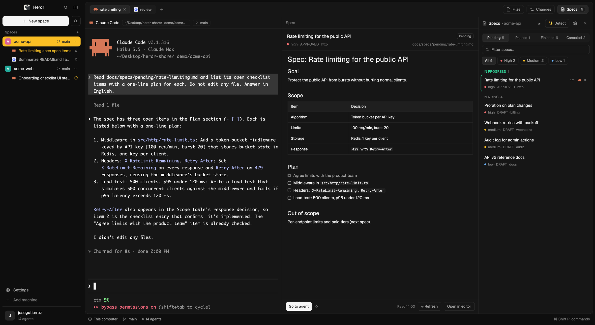

# minimalistic

A calm, neutral dark layout for [Herdr](https://herdr.dev), focused on agents and specs: each space lists its agents right under it, and a Specs panel ([SDD-Focused](https://github.com/josedugu/sdd-focused)) sits beside Files and Changes.

**Based on [0oz design](https://github.com/0OZ/0oz-design) by 0OZ** (Apache-2.0), whose look, theme and mods this layout keeps. Those mods are themselves derived from the ones shipped with Herdr.



## What's different from 0oz design

- **Agents under their space.** The separate agents list is gone: every space shows its agents nested below it, with the agent's own title, its icon and its state (spinner, "!", done dot). Click a space to fold or unfold its agents (clicking another space opens it); folded, it shows how many and the most urgent state.
- **Clear selection.** The active space sits on solid yellow with dark text; the focused agent's title is yellow.
- **Specs panel.** A "Specs" button in the tab bar, beside Files and Changes, with the pending count and a red dot when an agent on one of them needs you. It opens [SDD-Focused](https://github.com/josedugu/sdd-focused) (included).
- Mods are renamed `mn-*` (from `oz-*`) so this layout and 0oz design can be installed side by side.

## Install

```sh
git clone https://github.com/josedugu/minimalistic && cd minimalistic
cp layouts/minimalistic.json ~/.config/herdr-app/layouts/
cp themes/minimalistic.json ~/.config/herdr-app/themes/
cp -R mods/* ~/.config/herdr-app/mods/
herdr-app do layout.switch '{"name":"minimalistic"}'
```

`ctrl-shift-l` switches back to your previous layout; deleting the copied files removes this one.

`mn-spaces` runs `git` and `hc machine ls` to show branches and machines; `sdd-focused` runs `git`, `find` and `hc label` and starts agents only when you ask. Nothing here makes network requests.

## More

[`RECIPE.md`](RECIPE.md) describes the layout so an agent can rebuild it. Each modified file says what changed and who changed it.

## License

[Apache-2.0](LICENSE), like 0oz design and Herdr. Copyright of the original look, theme and `oz-*` mods: 0OZ; of Herdr's mods: the Herdr authors; of the changes listed above and SDD-Focused: José Gutiérrez.
