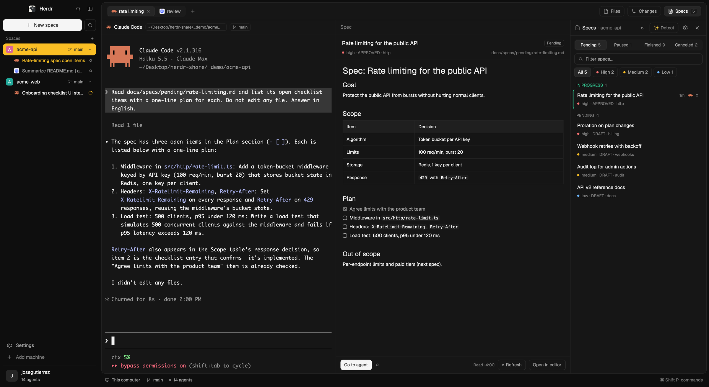

# minimalistic

A calm, neutral dark shell for Herdr, built on [0oz design](https://github.com/0OZ/0oz-design) by 0OZ and focused on agents and specs. The sidebar and the window share one near-black colour, and the work area is a single rounded, thinly bordered card inset into the window. Each space in the sidebar lists its own agents under it, the active space sits on solid yellow, and a Specs panel ([SDD-Focused](https://github.com/josedugu/sdd-focused)) opens beside Files and Changes.

## What you see

Left to right, on a `chrome` (#0e0e0e) window:

- **Sidebar, 256px, `chrome`, no divider.** Top to bottom:
  - Brand bar, 48px (`mn-chrome`): the Herdr logo, "Herdr", a search button and a sidebar toggle. On macOS it starts 76px in to clear the traffic lights.
  - A solid "New space" button (32px, 8px radius, `solid`) and a 32px outlined search button (`mn-spaces`).
  - "Spaces +" in a muted 11.5px label.
  - Space rows, 32px, grouped by machine: a 20px rounded initial tile, the name, then branch and ahead/behind counts in 11.5px, and at the end a fold chevron (11px). **The active space's row is solid `working` yellow (#fbbf24) with dark ink (`solid_foreground`) text, chevron and counts.** Worktree spaces nest under their repo's space on a 1px guide line.
  - **Under each space, its agents**, 28px rows indented 30px: the agent's icon (14px), its own title (the terminal title, else the tab's name), a machine name for remote ones, and its state mark. The focused agent's title is `working` yellow, medium weight; idle ones are `muted`.
  - Footer, 132px (`mn-chrome`): Settings and Add machine rows, a divider, an account chip.
- **Work area**, 6px in from the window edge: one card (`background` #161616, 12px radius, 1px `border` #242424, shadow `sm`):
  - Tab bar, 48px (`mn-tabs`): tabs in a segmented pill, a `+`, then outlined "Files", "Changes" and **"Specs"** buttons (28px). Specs shows a small count of the space's pending specs and a red dot when an agent working on one of them is blocked.
  - Terminal area, edge to edge (`terminal_padding` [10, 8]), panes divided by 1px hairlines with a 38px header (`mn-pane`) when split.
  - The right panel, 368px (280–900), hidden by default, a stack of `mn-files`, `mn-changes` and `sdd-focused`.
- **Status bar**, 26px, under the card (`mn-status`).

Colours: theme `minimalistic` (0oz's palette): background #161616, canvas #111111, chrome #0e0e0e, surface #151515, popover #1b1b1b, raised #1e1e1e, hover #1f1f1f, selected #262626, border #242424, input #2c2c2c, foreground #f5f5f5, muted #a3a3a3, dim #7a7a7a. Status: working #fbbf24, blocked #f87171, done #34d399, idle #737373. Light mode uses `paper`.

## How it behaves

- **Agents:** working shows a spinning ring, blocked a red "!", done a green dot, idle a ring, on each agent row, on the tab and in the pane header. Clicking an agent row focuses its pane.
- **Folding:** clicking a space that isn't active selects it and unfolds its agents; clicking the active space folds or unfolds them; the chevron toggles without selecting. Folded, the chevron shows the agent count and the most urgent state, so a blocked agent is never hidden. Folds are kept across restarts. Dragging still reorders spaces; right-click opens the space menu.
- **Specs:** the Specs button opens or closes the right panel on `sdd-focused`; the choice is remembered per space like Files and Changes. See SDD-Focused's recipe for the panel itself.
- **Tabs, panes, sidebar toggle, Files/Changes:** as in 0oz design.
- Keys are untouched.

## Built from

- Layout `minimalistic` (`layouts/minimalistic.json`): 0oz design's tree with the sidebar's `agents` block removed (so `spaces` fills `sidebar-lists`) and a third child `{ id: "specs", content: { mod: "sdd-focused" } }` in the `panel-body` stack. Root `theme` `{light: "paper", dark: "minimalistic"}`, `titlebar` none, `traffic_lights` [12, 16].
- Theme `minimalistic` (`themes/minimalistic.json`): 0oz's theme, renamed.
- Mods: `mn-chrome`, `mn-status`, `mn-files`, `mn-changes` (0oz's, renamed), `mn-tabs` (adds the Specs button: `specsBadge()` reads shared `sdd.badge` = `{space, n, pending: [paths]}` and marks blocked agents whose terminal label `spec` is one of those paths), `mn-pane` (titles an `sdd-focused` pane "Spec"), `mn-spaces` (agents per space: `agents.js` has `agentRow`, `agentFold`, `statusMark`, `agentIcon` and `onHighlight`, the dark-ink theme for the yellow row; fold state in `localStorage` key `spaces.agentsFolded`), and `sdd-focused`.
- Herdr functions added over 0oz: `agents()`, `terminals()` (labels), `localStorage`.

## Watch out

- `statusMark` and `agentIcon` exist in both `mn-spaces/agents.js` and `sdd-focused/lib/ui.js`: Herdr doesn't let one mod import another's files. Keep them in step.
- Text on the yellow row must use the dark-ink theme (`onHighlight`), including the git counts and the folded state mark, or it disappears.
- The space row selects on mouse up and drags on mouse down: the chevron stops both so it can toggle without selecting.
- All of 0oz design's notes still apply (keep pane and card `background` the same, `lone: false`).

## Done when

- `herdr-app check` passes for every mod in `mods/` (tested on Herdr 0.1.10), and `herdr-app status` shows no errors after `layout.switch {name: "minimalistic"}`.
- The sidebar shows each space with its agents under it, the active space on solid yellow with readable dark text, and the focused agent's title in yellow.
- Clicking the active space folds its agents; folded, the chevron shows their count.
- The tab bar has Files, Changes and Specs; Specs opens the SDD-Focused panel with the pending count on the button.
